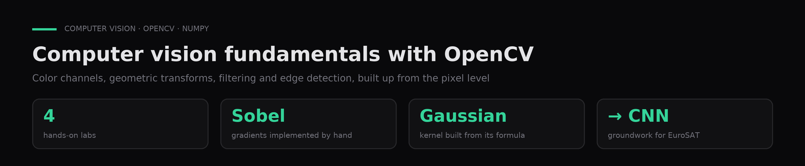

# Computer vision fundamentals with OpenCV

**Four labs on color channels, geometric transforms, filtering (box and Gaussian) and edge detection with a hand-built Sobel operator.**

`Python` · `OpenCV` · `NumPy` · `Matplotlib` · [Leer en español ↓](#español)

---

## Problem

Understand what each operation does to pixels before moving on to convolutional networks.

## Data

Sample photos loaded from /content in Colab; any RGB image works.

## Approach

Implementations in OpenCV and NumPy, a Gaussian kernel built from its formula, and X/Y gradients, with reasoned answers to each prompt.

## Results

A hand-built smoothing and edge-detection pipeline, the groundwork for the EuroSAT CNN project.

| Lab | Topic | What I built |
|---|---|---|
| 1 | Color spaces | RGB vs. grayscale, per-channel visualization, which channel highlights the subject |
| 2 | Geometric transforms | Translation, rotation, scaling, affine and projective (perspective) warps |
| 3 | Filtering | Box vs. Gaussian blur and the effect of kernel size |
| 4 | Edges | A Gaussian kernel built from its formula, plus Sobel X/Y gradients and magnitude, implemented by hand |

These labs are the groundwork for [land-cover-cnn-eurosat](https://github.com/GasparQC/land-cover-cnn-eurosat), where convolutions are learned instead of hand-designed.

## How to run

1. `pip install -r requirements.txt`, or open the notebooks in Google Colab.
2. Upload any RGB photo and point the `cv2.imread(...)` call at the top of each notebook to it.
3. Run `notebooks/01_color_channels.ipynb` to `notebooks/04_gaussian_and_sobel.ipynb` in order.

## Context

Coursework for **Image Processing** in the AI & Data Science program (Colegio Universitario IES · Universidad Siglo 21, 2026). Author: **Gaspar Quintana**.

---

## Español

**Cuatro prácticas sobre canales de color, transformaciones geométricas, filtrado (box y gaussiano) y detección de bordes con Sobel implementado a mano.**

**Problema.** Entender qué hace cada operación sobre los píxeles antes de usar redes convolucionales.

**Datos.** Imágenes propias de prueba (se cargan desde /content en Colab).

**Método.** Implementaciones con OpenCV y NumPy, un kernel gaussiano construido desde la fórmula y gradientes en X e Y, con respuestas razonadas a cada consigna.

**Resultados.** Un pipeline propio de suavizado y detección de bordes, que es la base del proyecto EuroSAT con CNN.

**Contexto.** Trabajo de **Procesamiento de Imágenes**, Tecnicatura en IA y Ciencia de Datos (Colegio Universitario IES · Universidad Siglo 21, 2026). Autor: **Gaspar Quintana**.
